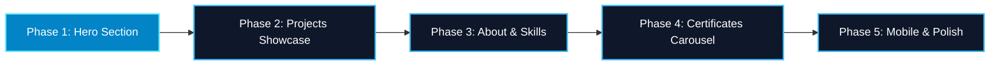

# Front-End Revamp Implementation Plan: Stellar Glimmer (Cryo Focused)

> **Design DNA**: Retain and enhance the existing portfolio identity (**Stellar-Cryo**), infused with **Genshin Impact Cryo Vision & Stellar Glimmer** aesthetics.  
> **Constraint**: **Zero 3D** — strictly lightweight 2D DOM, SVG, Framer Motion, and CSS for high framerates and zero battery drain.  
> **Protocol**: All phases execute via the **Dual-Brain Co-Developer Protocol** (Brain 1: Builder vs. Brain 2: Auditor).

---

## 1. Executive Roadmap & Status



| Phase | Section | Key Visual Focus | Status |
| :--- | :--- | :--- | :--- |
| **Phase 1** | **Hero Section** | Cryo Vision badge, diamond sigil, prismatic headline sweep, crystalline CTAs, avatar orbit crystals | ✅ **Completed & Verified** (`3e0b709`) |
| **Phase 2** | **Projects Showcase** | Genshin Cryo card HUD, diamond corner pips, filter tabs, photo crossfades, status ribbons | ⏳ **Ready for Feedback** |
| **Phase 3** | **About & Skills** | Cryo Talent / Constellation node layout, interactive skill linking, milestone stats bento | ⏳ **Pending Phase 2** |
| **Phase 4** | **Certificates Carousel** | Crystalline refraction borders, credential verification chips, enhanced PDF modal viewer | ⏳ **Pending Phase 3** |
| **Phase 5** | **Mobile & Polish** | Haptic-like touch feedback, safe-area inset ergonomics, zero-layout shift audit | ⏳ **Final Polish** |

---

## 2. Phase 1 Retrospective (Completed)

> [!NOTE]
> Phase 1 was drafted by **Brain 1**, audited by **Brain 2** for text clipping and touch target ergonomics, verified with `npm run build` (5.03s, 0 errors), and pushed to `main` at [`3e0b709`](https://github.com/Qualestrom/kweyl_portfolio/commit/3e0b709).

* **Genshin Cryo Vision Tag**: Added `CRYO // VISION: ARCHITECT` with flanking four-pointed stars (`✦`).
* **Cryo Rhombus Sigil**: Converted the greeting indicator into a 45-degree rotating diamond with soft core pulse.
* **Prismatic Text Shimmer**: Animated text fill on highlighted keywords (`PRECISION`, `PERFORMANCE`) simulating ice crystal refraction.
* **Crystalline CTA Buttons**: Primary button upgraded with ice gradient and dynamic light sweep (`cryoGlintSweep`); secondary button with frosted glass depth and diamond borders.
* **Avatar Orbit Rings**: Added 4 cardinal floating Cryo star crystals to the portrait orbit ring.

---

## 3. Phase 2: Projects Showcase (Next Milestone)

### Implementation Scope
1. **Genshin Cryo Card HUD Framing**:
   - Card borders upgraded with subtle diamond corner accents (`◇`) and ice-sheen border reflections.
   - Status badges (*Deployed*, *In Progress*, *Confidential*) restyled with Cryo elemental gemstone borders and glowing status dots.
2. **Category Filter Tabs**:
   - Add responsive filter tabs: `All Projects`, `Web & Full-Stack`, `Mobile (React Native / Expo)`, `Systems & Hardware`.
   - Smooth animated active indicator sliding between tabs with Framer Motion layout animations.
3. **Featured Project Badges**:
   - Highlight *M7 Grand Prix RSVP* (3D Web) and *The Pickle* (Mobile / Supabase) with a custom Genshin-inspired Cryo star ribbon.
4. **Enhanced Gallery Crossfades**:
   - Refine the multi-image gallery with smooth opacity/scale crossfades, thumbnail preview strip, and touch swipe.

### ❓ Locked Decisions for Phase 2 (User Approved)
* **Filter Tabs Placement**: Floating side-aligned tabs with the feel of a floating Genshin Oculus (gentle hovering levitation physics, diamond rhombus markers, non-rotating).
* **View Mode**: Option A — retain the sleek horizontal carousel with left/right drag and keyboard navigation.
* **Project Badging**: Kept as-is for future automation feature; no artificial rarity crests.

---

## 4. Phase 3: About & Skills

### Implementation Scope
1. **Cryo Talent Cards**:
   - 4 frosted crystalline Talent Cards with diamond accents (Software, Mobile, Cloud, Design).
   - Clean, professional styling with zero gimmicky AI embellishments.
2. **Interactive Project-Skill Linking**:
   - Hovering or clicking a skill subtly illuminates matching project cards in the showcase.
3. **Status Badge**:
   - Clean standard professional status (`Open to Work`, `Open to Freelance`) with Cryo gemstone indicator.

### ❓ Locked Decisions for Phase 3 (User Approved)
* **Skill Presentation**: Option A — 4 frosted crystalline Talent Cards.
* **Status Badge**: Standard professional format, clean and authentic.

---

## 5. Phase 4: Certificates Carousel

### Implementation Scope
1. **Prismatic Crystal Display**:
   - Refine the cylindrical carousel cards with frosted ice borders and Cisco / Python accreditation badges.
2. **High-Fidelity PDF Viewer Modal**:
   - Fast PDF modal preview with zoom and direct verification links.

### ❓ Locked Decisions for Phase 4 (User Approved)
* **Carousel Format**: Option A — retain the smooth cylindrical rotation with keyboard and navigation arrow controls.

---

## 6. Phase 5: Mobile Ergonomics & Overall Polish

### Implementation Scope
1. **Full-Width Frosted Bottom Bar**:
   - Convert mobile navigation from floating dock into a sleek, full-width frosted glass bottom bar with `env(safe-area-inset-bottom)` support.
2. **Zero-Layout Shift & Contrast Verification**:
   - Complete audit across desktop, laptop, tablet, and mobile viewports.

### ❓ Locked Decisions for Phase 5 (User Approved)
* **Mobile Nav Style**: Full-width frosted glass bottom bar.

---

## 7. Dual-Brain Review Protocol Checklist

For every phase commit, the following 5 dimensions will be cross-examined:

```
[ ] 1. Design DNA: Does it adhere strictly to the Genshin Cryo Stellar Glimmer palette without straying?
[ ] 2. Zero 3D: Are all visuals pure 2D DOM, SVG, and CSS (no heavy 3D canvases)?
[ ] 3. Responsive Resilience: Zero horizontal scroll on 375px, 768px, 1024px, 1440px.
[ ] 4. React State & Admin Hygiene: Do admin edit modals and inputs operate seamlessly?
[ ] 5. Empirical Proof: Does 'npm run build' pass cleanly with zero errors?
```
