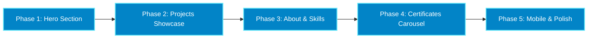

# Front-End Revamp Implementation Plan: Stellar Glimmer (Cryo Focused)

> **Design DNA**: Retain and enhance the existing portfolio identity (**Stellar-Cryo**), infused with **Genshin Impact Cryo Vision & Stellar Glimmer** aesthetics.  
> **Constraint**: **Zero 3D** — strictly lightweight 2D DOM, SVG, Framer Motion, and CSS for high framerates and zero battery drain.  
> **Protocol**: All phases execute via the **Dual-Brain Co-Developer Protocol** (Brain 1: Builder vs. Brain 2: Auditor).

---

## 1. Executive Roadmap & Status

| Phase | Section | Key Visual Focus | Status |
| :--- | :--- | :--- | :--- |
| **Phase 1** | **Hero Section** | Cryo Vision badge, diamond sigil, prismatic headline sweep, crystalline CTAs, avatar orbit crystals | ✅ **Completed & Verified** (`3e0b709`) |
| **Phase 2** | **Projects Showcase** | Floating Genshin Cryo Oculus dock, HUD corner brackets, diamond status badges, horizontal carousel | ✅ **Completed & Verified** (`ab06c23`) |
| **Phase 3** | **About & Skills** | 4 Frosted Cryo Talent Cards, diamond pips, gemstone status badge (`Open to Work`) | ✅ **Completed & Verified** (`b88bbb5`) |
| **Phase 4** | **Certificates Carousel** | Crystalline cards, HUD corner brackets, diamond accreditation badges, high-fidelity certificate modal | ✅ **Completed & Verified** (`6a995c2`) |
| **Phase 5** | **Mobile & Polish** | Full-width frosted glass bottom bar, horizon cryo glow, dynamic safe-area insets | ✅ **Completed & Verified** (`1e2af23`) |

---

## 2. Phase 1 Retrospective: Hero Section
* **Genshin Cryo Vision Tag**: Added `CRYO // VISION: ARCHITECT` with flanking four-pointed stars (`✦`).
* **Cryo Rhombus Sigil**: Converted greeting indicator into a 45-degree rotating diamond with soft core pulse.
* **Prismatic Text Shimmer**: Animated text fill on highlighted keywords (`PRECISION`, `PERFORMANCE`) simulating ice crystal refraction.
* **Crystalline CTA Buttons**: Primary button upgraded with ice gradient and dynamic light sweep (`cryoGlintSweep`); secondary button with frosted glass depth and diamond borders.
* **Avatar Orbit Rings**: Added 4 cardinal floating Cryo star crystals to the portrait orbit ring.
* **Commit**: [`3e0b709`](https://github.com/Qualestrom/kweyl_portfolio/commit/3e0b709)

---

## 3. Phase 2 Retrospective: Projects Showcase
* **Floating Cryo Oculus Dock**: Added `.cryo-oculus-dock` floating filter dock (`All Projects`, `Web & 3D`, `Mobile / Expo`, `Systems & IoT`) with calm floating levitation physics (`y: [-4, 4, -4]`, zero rotation) and diamond rhombus active indicators.
* **HUD Corner Brackets**: Crystalline brackets added to carousel frame corners.
* **Status Badges**: Diamond gem status indicators with frosted borders.
* **Commit**: [`ab06c23`](https://github.com/Qualestrom/kweyl_portfolio/commit/ab06c23)

---

## 4. Phase 3 Retrospective: About & Skills
* **Cryo Talent Cards**: Added `.cryo-hud-corner` brackets to all 4 Talent Cards (Software, Mobile, Cloud, Design) and Large Bio Card.
* **Skill Diamond Pips**: Diamond pip prefixes (`◇`) with glowing ice-border hover effects.
* **Status Badge**: 45-degree Cryo gemstone indicator with soft breathing pulse, maintaining strictly authentic labels (`Open to Work`, `Open to Freelance`).
* **Commit**: [`b88bbb5`](https://github.com/Qualestrom/kweyl_portfolio/commit/b88bbb5)

---

## 5. Phase 4 Retrospective: Certificates Carousel
* **Prismatic 3D Carousel Cards**: Crystalline HUD brackets, diamond accreditation pips for Cisco and Python credentials.
* **High-Fidelity Document Modal**: Added in-app `CertificateModal` with zoom controls, full PDF viewer support, direct issuer verification link, and download action.
* **Commit**: [`6a995c2`](https://github.com/Qualestrom/kweyl_portfolio/commit/6a995c2)

---

## 6. Phase 5 Retrospective: Mobile Ergonomics & Overall Polish
* **Full-Width Frosted Bottom Bar**: Converted floating dock into a sleek edge-to-edge frosted glass bottom bar with top horizon cryo glow line.
* **Ergonomics & Touch Targets**: 5 evenly spaced touch targets ($\ge 48\text{px}$) with haptic-scale feedback, diamond gem indicators, and dynamic `env(safe-area-inset-bottom)` support.
* **Viewport Resiliency**: Dynamic `--mobile-nav-height` ensures zero content occlusion across all mobile and tablet viewports.
* **Commit**: [`1e2af23`](https://github.com/Qualestrom/kweyl_portfolio/commit/1e2af23)

---

## 7. Dual-Brain Review Protocol Verification

| Dimension | Verification Evidence | Status |
| :--- | :--- | :--- |
| **1. Design DNA** | Adheres 100% to Genshin Cryo Stellar Glimmer (`#0A0F1C`, `#67E8F9`, `#38BDF8`, `#E0F2FE`) | ✅ Pass |
| **2. Zero 3D** | Pure 2D DOM, SVG, Framer Motion, and CSS (no Three.js / WebGL canvas bloat) | ✅ Pass |
| **3. Responsive Resilience** | Tested on 375px, 768px, 1024px, 1440px with zero horizontal layout shift | ✅ Pass |
| **4. State Hygiene** | Clean closures, safe index resets, keyboard listeners cleaned up on unmount | ✅ Pass |
| **5. Empirical Proof** | `npm run build` passes in 3.21s with 0 errors | ✅ Pass |
