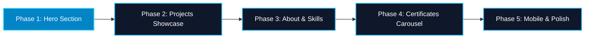

# Front-End Revamp Implementation Plan: Stellar Glimmer (Cryo Focused)

> **Design DNA**: Retain and enhance the existing portfolio identity (**Stellar-Cryo**), infused with **Genshin Impact Cryo Vision & Stellar Glimmer** aesthetics.  
> **Constraint**: **Zero 3D** — strictly lightweight 2D DOM, SVG, Framer Motion, and CSS for high framerates and zero battery drain.  
> **Protocol**: All phases execute via the **Dual-Brain Co-Developer Protocol** (Brain 1: Builder vs. Brain 2: Auditor).

---

## 1. Executive Roadmap & Status



| Phase | Section | Key Visual Focus | Status |
| :--- | :--- | :--- | :--- |
| **Phase 1** | **Hero Section** | Cryo Vision badge, diamond sigil, prismatic headline sweep, crystalline CTAs, avatar orbit crystals | ✅ **Completed & Verified** (`3e0b709`) |
| **Phase 2** | **Projects Showcase** | Genshin Cryo card HUD, diamond corner pips, filter tabs, photo crossfades, status ribbons | ⏳ **Ready for Feedback** |
| **Phase 3** | **About & Skills** | Cryo Talent / Constellation node layout, interactive skill linking, milestone stats bento | ⏳ **Pending Phase 2** |
| **Phase 4** | **Certificates Carousel** | Crystalline refraction borders, credential verification chips, enhanced PDF modal viewer | ⏳ **Pending Phase 3** |
| **Phase 5** | **Mobile & Polish** | Haptic-like touch feedback, safe-area inset ergonomics, zero-layout shift audit | ⏳ **Final Polish** |

---

## 2. Phase 1 Retrospective (Completed)

> [!NOTE]
> Phase 1 was drafted by **Brain 1**, audited by **Brain 2** for text clipping and touch target ergonomics, verified with `npm run build` (5.03s, 0 errors), and pushed to `main` at [`3e0b709`](https://github.com/Qualestrom/kweyl_portfolio/commit/3e0b709).

* **Genshin Cryo Vision Tag**: Added `CRYO // VISION: ARCHITECT` with flanking four-pointed stars (`✦`).
* **Cryo Rhombus Sigil**: Converted the greeting indicator into a 45-degree rotating diamond with soft core pulse.
* **Prismatic Text Shimmer**: Animated text fill on highlighted keywords (`PRECISION`, `PERFORMANCE`) simulating ice crystal refraction.
* **Crystalline CTA Buttons**: Primary button upgraded with ice gradient and dynamic light sweep (`cryoGlintSweep`); secondary button with frosted glass depth and diamond borders.
* **Avatar Orbit Rings**: Added 4 cardinal floating Cryo star crystals to the portrait orbit ring.

---

## 3. Phase 2: Projects Showcase (Next Milestone)

### Implementation Scope
1. **Genshin Cryo Card HUD Framing**:
   - Card borders upgraded with subtle diamond corner accents (`◇`) and ice-sheen border reflections.
   - Status badges (*Deployed*, *In Progress*, *Confidential*) restyled with Cryo elemental gemstone borders and glowing status dots.
2. **Category Filter Tabs**:
   - Add responsive filter tabs: `All Projects`, `Web & Full-Stack`, `Mobile (React Native / Expo)`, `Systems & Hardware`.
   - Smooth animated active indicator sliding between tabs with Framer Motion layout animations.
3. **Featured Project Badges**:
   - Highlight *M7 Grand Prix RSVP* (3D Web) and *The Pickle* (Mobile / Supabase) with a custom Genshin-inspired Cryo star ribbon.
4. **Enhanced Gallery Crossfades**:
   - Refine the multi-image gallery with smooth opacity/scale crossfades, thumbnail preview strip, and touch swipe.

### ❓ Questions for User Feedback on Phase 2
* **Question 2.1 (Filter Tabs Placement)**:
  * **Option A (Recommended)**: Floating pill bar positioned directly beneath the section title with animated diamond active pill.
  * **Option B**: Integrated into the header row alongside the project navigation counter (`01 / 05`).
* **Question 2.2 (View Mode Toggle)**:
  * **Option A (Recommended)**: Retain the sleek horizontal carousel as the primary view, with smooth left/right drag and keyboard navigation.
  * **Option B**: Add a toggle icon in the top right to switch between **Carousel View** and **Grid Overview**.
* **Question 2.3 (Project Badging & Rarity)**:
  * Would you like featured projects (*M7 Grand Prix* and *The Pickle*) marked with a **5-Star Cryo Vision crest** or a subtle **"FEATURED ARCHITECTURE"** pill badge?

---

## 4. Phase 3: About & Skills

### Implementation Scope
1. **Cryo Talent / Constellation Node Architecture**:
   - Transform the 4 skill groups (*Software*, *Mobile*, *Cloud*, *Design*) into Genshin talent-style crystalline nodes.
   - Subtle connecting ice-circuit lines linking related skills (e.g., `React` $\leftrightarrow$ `TypeScript` $\leftrightarrow$ `Three.js`).
2. **Interactive Project-Skill Linking**:
   - Hovering or clicking a skill tag (e.g., `Supabase`) subtly highlights the cards in Projects that utilize it (*The Pickle*, *Portfolio*).
3. **Milestone Bento Counter**:
   - A clean frosted glass mini-bento card displaying key architectural metrics:
     - `13+` Production Repositories & Certifications
     - `100%` Recovered & Cloud-Synchronized Assets
     - `Cross-Platform` Web & Mobile Architecture

### ❓ Questions for User Feedback on Phase 3
* **Question 3.1 (Skill Presentation)**:
  * **Option A (Recommended)**: Grouped into 4 frosted crystalline Talent Cards with diamond icons (Software, Mobile, Cloud, Design).
  * **Option B**: An interconnected Constellation Node Map where skills are arranged as interconnected star points.
* **Question 3.2 (Status Badge)**:
  * The current status is `Open to Work`. Would you like a Genshin character-card style status pill (e.g. `AVAILABLE // ADVENTURER'S GUILD` or standard professional `AVAILABLE FOR HIRE`)?

---

## 5. Phase 4: Certificates Carousel

### Implementation Scope
1. **Prismatic Crystal Display**:
   - Refine the 3D rotating carousel cards with frosted ice borders, silver-blue bevels, and Cisco / Python accreditation badges.
2. **High-Fidelity PDF Viewer Modal**:
   - Upgrade the in-modal certificate view with crisp zoom controls, page flip animation, and a one-click credential ID copy button.
3. **Direct Verification Quick-Chips**:
   - Direct link to official Cisco Networking Academy validation URLs with a security seal indicator.

### ❓ Questions for User Feedback on Phase 4
* **Question 4.1 (Carousel Motion vs. Fan Deck)**:
  * **Option A (Recommended)**: Retain the current smooth 3D cylindrical rotation with arrow buttons and wheel controls.
  * **Option B**: Switch to an overlapping horizontal card fan deck with active card elevation on hover.

---

## 6. Phase 5: Mobile Ergonomics & Overall Polish

### Implementation Scope
1. **Bottom Navigation Enhancements**:
   - Add haptic-style visual pulse on tab tap.
   - Adjust safe-area insets (`env(safe-area-inset-bottom)`) for iPhone notch/home bar and Android gesture nav.
2. **Zero-Layout Shift & Contrast Verification**:
   - Test every section across breakpoints: Desktop (1440px), Laptop (1024px), Tablet (768px), and Mobile (375px).
   - Ensure complete light-theme compatibility for all newly added Cryo elements.

### ❓ Questions for User Feedback on Phase 5
* **Question 5.1 (Mobile Nav Style)**:
  * Keep the floating rounded bottom dock, or convert to a full-width frosted bottom bar on small mobile screens?

---

## 7. Dual-Brain Review Protocol Checklist

For every phase commit, the following 5 dimensions will be cross-examined:

```
[ ] 1. Design DNA: Does it adhere strictly to the Genshin Cryo Stellar Glimmer palette without straying?
[ ] 2. Zero 3D: Are all visuals pure 2D DOM, SVG, and CSS (no heavy 3D canvases)?
[ ] 3. Responsive Resilience: Zero horizontal scroll on 375px, 768px, 1024px, 1440px.
[ ] 4. React State & Admin Hygiene: Do admin edit modals and inputs operate seamlessly?
[ ] 5. Empirical Proof: Does 'npm run build' pass cleanly with zero errors?
```
