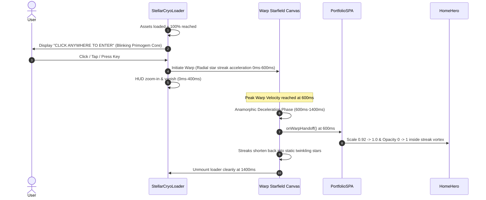

# Approach 1: The Astral Navigator
### Deep Celestial Parallax & Anamorphic Star Warp

> **Design Theme**: Celestial Traveler · Teyvat Starlight · Primogem Constellations  
> **Target Experience**: Cinematic, deeply immersive, visceral spatial depth.

---

## 1. Executive Summary & Design Rationale

In the current implementation, navigating between sections produces a `72px` background offset across a `100vw` (`~1920px`) section transition—amounting to only **~3.7% visual travel**. To the human eye, the background appears essentially stationary while the foreground slides. Furthermore, the opening hyperspace warp abruptly dissipates before the user can appreciate the physical transition into the portfolio space.

**The Astral Navigator** solves this by converting the background into a **3-tiered true deep-space parallax camera** with horizontal particle velocity stretching, combined with an **anamorphic deceleration warp** that physically pulls the hero section out of the dissipating star-streaks.

```
┌────────────────────────────────────────────────────────────────────────┐
│                        SPATIAL DEPTH ARCHITECTURE                      │
├────────────────────────────────────────────────────────────────────────┤
│ Layer 0: Deep Nebulae Canvas        ───▶  -15vw  (Slow cosmic drift)   │
│ Layer 1: Constellation Grid         ───▶  -38vw  (Medium starfield)    │
│ Layer 2: Near Primogems & Dust      ───▶  -80vw  (High-speed near field│
│ Layer 3: Foreground Content Track   ───▶ -100vw  (Active section page) │
└────────────────────────────────────────────────────────────────────────┘
```

---

## 2. Visual Reference Card (Genshin Cryo / Astral Motif)

```markdown
### Visual Reference Card: The Astral Navigator
1. **Palette Tokens**:
   - Deep Abyss Floor: `#040711` (Dark) / `#F1F5F9` (Light)
   - Starlight Primary: `#38BDF8` (Cryo Frost)
   - High-Tier Primogem Core: `#FFFFFF` / `#0284C7` (Light)
   - Warp Streak Trail: `rgba(56, 189, 248, 0.85)` tapering to `rgba(2, 132, 199, 0)`

2. **Geometric Primitives**:
   - 4-point Primogem stars with 0.22 inner-to-outer ratio.
   - Dynamic connective constellation laser filaments (hairline `1px`, alpha `0.35 → 0.85`).
   - Radial warp streak vectors originating from viewport vanishing point `(0.5w, 0.48h)`.

3. **Motion Curves**:
   - Warp Deceleration: `cubic-bezier(0.16, 1, 0.3, 1)` over `1200ms`.
   - Section Camera Spring: `stiffness: 180, damping: 24, mass: 0.85`.
   - Velocity Streak Factor: `scaleX = 1 + min(abs(vx) * 0.0035, 2.2)`.

4. **Restraint Boundary**:
   - NO spinning galaxy spirals or rainbow colored nebulae.
   - NO particle explosions upon clicking cards.
   - Star streaks exist ONLY during active transitions and warp; idle canvas remains tranquil.
```

---

## 3. Detailed Component Architecture

### A. Opening Screen & Anamorphic Warp Transition



#### Key Implementation Details:
1. **Vanishing Point Centering**: The warp streaks emanate from the exact center of the screen `(cx, cy)`, where the hero portrait will soon land.
2. **Anamorphic Stretch**: During warp, stars do not simply move faster—their length scales proportionally to `velocity * zDepth`:
   $$\text{streakLength} = \text{baseLength} \times (1 + \text{speed} \times 0.08)$$
3. **Continuous Deceleration Hand-Off**: Instead of fading to a white screen or sudden blank frame, the canvas star positions from the end of the warp are seeded directly into `StellarBackground`, creating **zero-cut continuity**.

---

### B. High-Visibility Multi-Tier Background Parallax

To make background motion immediately and unmistakably apparent when swiping between sections:

| Layer | Component | Per-Section Travel | Visual Content | Depth Feel |
| :--- | :--- | :--- | :--- | :--- |
| **Foreground** | `PortfolioSPA` | `-100vw` (`-100%`) | Section cards, typography, forms | In-your-face interactive layer |
| **Near Field** | `StellarBackground (Layer 2)` | **`-80vw`** | Large 4-point Primogem stars, bright dust motes | Glides rapidly, establishing close foreground depth |
| **Mid Field** | `StellarBackground (Layer 1)` | **`-38vw`** | Constellation stars, laser filaments, circuit lines | Medium-distance spatial anchor |
| **Deep Field** | `InteractiveBackground` | **`-15vw`** | Ambient cosmic nebulae, subtle gradient clouds | Distant infinite horizon |

#### Dynamic Horizontal Velocity Shearing (The "Warp Glimpse"):
When the user triggers a section slide, the particle system measures the spring velocity `vx` of the track. If `abs(vx) > 120px/s`, near-field stars stretch horizontally by:
```javascript
const stretchFactor = Math.min(Math.abs(vx) * 0.0025, 1.8);
ctx.scale(1 + stretchFactor, 1);
```
This gives the user an instantaneous visual rush of horizontal speed that immediately informs the brain that the entire environment is translating in space.

---

## 4. Technical File Changes & Scope

1. **`src/components/StellarCryoLoader.jsx`**:
   - Rewrite `handleEnter` to compute unified particle vectors handed off to `StellarBackground`.
   - Replace linear warp timer with an exponential ease-out anamorphic deceleration curve.
2. **`src/components/StellarBackground.jsx`**:
   - Split particle generation into 3 depth buckets (`z: 0.15`, `z: 0.38`, `z: 0.80`).
   - Multiply section offset by each particle's specific `z` depth parameter:
     $$x_{\text{render}} = (x_{\text{base}} + \text{currentParallaxX} \times z) \pmod w$$
   - Implement seamless continuous wrapping so stars never pop in or out at screen edges.
3. **`src/components/PortfolioSPA.jsx`**:
   - Pass real-time motion velocity `x.getVelocity()` down into the background components via ref or animation frame.

---

## 5. Pros, Cons & Evaluation

### Advantages
- **Cinematic Drama**: Creates an immediate "Triple-A" game feel that dazzles recruiters within the first 3 seconds.
- **Directly Solves Problem**: Background movement jumps from unnoticeable (`3.7%`) to vivid, high-craft depth (`80%` near-field travel).
- **Pure Vector Math**: Zero heavy textures or WebGL shaders required; runs on lightweight Canvas 2D at 60–120 FPS.

### Trade-Offs
- Requires careful tuning of near-field star opacity so rapid motion does not distract from reading text in the About and Projects sections.
- Must disable velocity stretching when `prefers-reduced-motion` is active.

