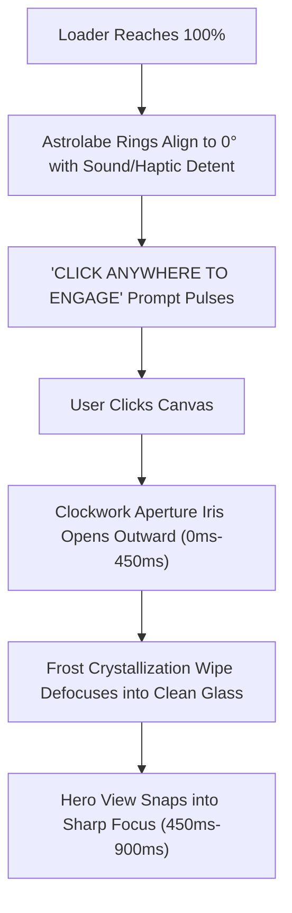

# Approach 2: The Snezhnayan Astrolabe
### Crystalline Clockwork & Rotational Horizon

> **Design Theme**: Snezhnayan Clockwork Precision · Marionette Sandrone Astrolabe · Mechanical Elegance  
> **Target Experience**: Tactile, architectural, intellectually disciplined, high mechanical feedback.

---

## 1. Executive Summary & Design Rationale

While linear parallax (moving stars left or right) is standard, the human eye often filters out uniform horizontal drifting as background noise. **The Snezhnayan Astrolabe** approach introduces a second, orthogonal motion vector: **rotational mechanics**.

Inspired by Snezhnayan Fatui engineering (the clockwork motifs of Sandrone / Marionette, refined astrolabes, and cryogenic mechanical chronometers), this approach roots the background in an elegant, faint **Celestial Astrolabe Horizon**. As you slide from section to section, the starfield translates horizontally while the giant background astrolabe dial visibly **rotates and ratchets by 36° per section**, providing unmistakable, tactile visual confirmation of state changes.

```
┌────────────────────────────────────────────────────────────────────────┐
│                      HYBRID DUAL-VECTOR MOTION                         │
├────────────────────────────────────────────────────────────────────────┤
│ Vector 1: Linear Parallax           ───▶  -55vw horizontal shift       │
│ Vector 2: Angular Astrolabe Dial    ───▶  -36.0° spring rotation       │
│ Visual Feedback:                    ───▶  Mechanical ratchet lock      │
└────────────────────────────────────────────────────────────────────────┘
```

---

## 2. Visual Reference Card (Snezhnayan Clockwork Motif)

```markdown
### Visual Reference Card: The Snezhnayan Astrolabe
1. **Palette Tokens**:
   - Deep Industrial Obsidian: `#030712` (Dark) / `#F8FAFC` (Light)
   - Glacial Steel Blue: `#64748B` / `#0284C7` (Dials & Graduations)
   - Crystalline Frost Accent: `#38BDF8` (Active indices & alignment reticles)
   - Mechanical Reflection: `rgba(255, 255, 255, 0.08)` hairline rings

2. **Geometric Primitives**:
   - Concentric astronomical coordinate rings (radii: 220px, 480px, 780px).
   - Fine 1px radial tick marks at 10° increments with Roman/degree numerals.
   - Dual-axis interlocking gear teeth and an 8-point cryogenic compass rose.

3. **Motion Curves**:
   - Rotational Snap: Spring physics `stiffness: 220, damping: 28, mass: 1.1`.
   - Ratchet Detent Easing: Micro-overshoot (`1.02x` angle) settling firmly into lock.
   - Aperture Shutter: `cubic-bezier(0.85, 0, 0.15, 1)` over `700ms`.

4. **Restraint Boundary**:
   - NO heavy steampunk brass, brown copper, or steam smoke.
   - Keep line weights at strict hairlines (`0.75px` to `1.2px`) with low alpha (`0.08` to `0.22`).
   - The astrolabe must remain an atmospheric architectural watermark, never competing with foreground cards.
```

---

## 3. Detailed Component Architecture

### A. Opening Screen: Aperture Iris Shutter Transition



#### Transition Choreography:
1. **The Alignment Phase**: When loading completes, three concentric astrolabe rings in the center of the loader slowly rotate into synchronization, locking with a crisp visual alignment pulse.
2. **The Iris Aperture Release**: Upon clicking, rather than a generic warp speed streak, the central circle expands like an ultra-precise optical aperture shutter (`clip-path: circle(0% at 50% 50%) → circle(150% at 50% 50%)`).
3. **Crystalline Defocus**: As the aperture clears, a brief flash of glacial refraction sparkles on the perimeter and dissipates smoothly into the main hero view.

---

### B. Rotational Astrolabe Parallax Background

Instead of a standard flat starfield alone, `StellarBackground` renders two coordinated systems:

#### 1. The Dynamic Celestial Astrolabe (Layer 1):
A large, vector-rendered astrolabe anchored in the upper-right quadrant of the viewport (`x: 75vw, y: 35vh`):
- **Section 0 (Home)**: Astrolabe rotation = `0.0°` (Aligned to Origin).
- **Section 1 (About)**: Astrolabe rotation = `-36.0°` (Calibrated to Persona).
- **Section 2 (Projects)**: Astrolabe rotation = `-72.0°` (Calibrated to Creations).
- **Section 3 (Certs)**: Astrolabe rotation = `-108.0°` (Calibrated to Mastery).
- **Section 4 (Contact)**: Astrolabe rotation = `-144.0°` (Calibrated to Signal).

Because rotational movement is intrinsically distinct from the horizontal sliding of the website cards, the user's peripheral vision immediately registers that **the entire environment is actively navigating**.

#### 2. Synchronized Frost Star Particles (Layer 2):
Surrounding the astrolabe, cold crystalline star motes glide horizontally with a generous travel amplitude of **`-55vw` per section**, accompanied by subtle vertical buoyancy (`Math.sin(frame * 0.02) * 1.5px`) that mimics ice crystals suspended in zero gravity.

---

## 4. Technical File Changes & Scope

1. **`src/components/StellarCryoLoader.jsx`**:
   - Add canvas geometry for concentric astrolabe gears during the loader phase.
   - Implement the aperture shutter exit transition via CSS mask / SVG clipPath.
2. **`src/components/StellarBackground.jsx`**:
   - Add high-performance Canvas path rendering for the celestial astrolabe dial (pre-rendered to an off-screen canvas for zero redraw lag).
   - Hook rotation angle directly to Framer Motion spring:
     ```javascript
     const targetAngle = -activeSection * (Math.PI / 5);
     currentAngle += (targetAngle - currentAngle) * 0.12;
     ```
3. **`src/components/InteractiveBackground.jsx`**:
   - Align circuit lines to radiate concentrically from the astrolabe's center point rather than an arbitrary rectangular grid.

---

## 5. Pros, Cons & Evaluation

### Advantages
- **Unmistakable Motion Signal**: Rotational movement provides high visual contrast against horizontal card scrolling—making motion 100% obvious even at subtle opacities.
- **Deep Lore & Identity**: Directly reflects the Snezhnayan "Clockwork & Cryo" architectural aesthetic, distinguishing the portfolio from every generic space template on the internet.
- **Micro-Interaction Polish**: Mechanical dial alignment feels tactile, deliberate, and satisfying.

### Trade-Offs
- Requires precise geometric canvas drawing with pre-rendered offscreen buffers to guarantee 60 FPS on lower-end devices.
- Must keep dial opacity strictly below `0.20` in dark mode and `0.14` in light mode so it never obscures project descriptions.

