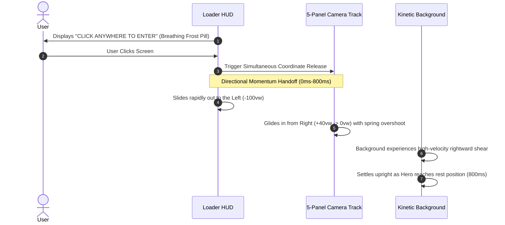

# Approach 3: The Cryo-Fluid Dynamics
### Velocity-Sheared HUD & Atmospheric Chambers

> **Design Theme**: Modern Awwwards Minimalist · Fluid Kinetic Motion · Atmospheric Environmental Lighting  
> **Target Experience**: Silky smooth 120 FPS fluidity, organic spatial feedback, modern software-craft prestige.

---

## 1. Executive Summary & Design Rationale

Rather than relying solely on individual star points, **The Cryo-Fluid Dynamics** approaches spatial motion from an environmental perspective: **lighting and momentum**.

When moving between different sections of an expansive portfolio, the atmosphere itself should adapt. This approach introduces two revolutionary visual cues:
1. **Dynamic Atmospheric Chambers**: Five distinct ambient radial lighting fields that live in the background, physically traveling `-65vw` per section and smoothly cross-blending their color temperatures (e.g., pure Arctic Cyan in Home → Glacial Indigo in About → Aurora Teal in Projects → Celestial Sapphire in Certs).
2. **Velocity Shearing & Tilt**: The background canvas directly samples the spring physics velocity of the section track. During rapid swipes or navigations, the entire particle grid **dynamically skews and tilts along the movement vector** (`skewX(-vx * 0.035deg)`), snapping upright as the track settles.

```
┌────────────────────────────────────────────────────────────────────────┐
│                   ENVIRONMENTAL CHAMBER ARCHITECTURE                   │
├────────────────────────────────────────────────────────────────────────┤
│ Section 0 (Home):     Arctic Cyan Chamber       ──▶ rgba(56,189,248,0.12)│
│ Section 1 (About):    Glacial Indigo Chamber    ──▶ rgba(99,102,241,0.10)│
│ Section 2 (Projects): Aurora Teal Chamber       ──▶ rgba(20,184,166,0.10)│
│ Section 3 (Certs):    Celestial Starlight       ──▶ rgba(147,197,253,0.11)│
│ Section 4 (Contact):  Abyss Sapphire Chamber    ──▶ rgba(59,130,246,0.10)│
└────────────────────────────────────────────────────────────────────────┘
```

---

## 2. Visual Reference Card (Fluid Kinetic Cryo Motif)

```markdown
### Visual Reference Card: The Cryo-Fluid Dynamics
1. **Palette Tokens**:
   - Canvas Abyss Floor: `#050813` (Dark) / `#F8FAFC` (Light)
   - Atmospheric Aurora 1: `rgba(56, 189, 248, 0.12)` (Arctic Cyan)
   - Atmospheric Aurora 2: `rgba(99, 102, 241, 0.10)` (Glacial Indigo)
   - Atmospheric Aurora 3: `rgba(20, 184, 166, 0.10)` (Aurora Teal)
   - Kinetic Velocity Line: `rgba(255, 255, 255, 0.40)` transient trail

2. **Geometric Primitives**:
   - Large blurred radial light orbs (`radius: 500px`, `blur: 80px`).
   - Orthogonal Cartesian dot grid with velocity-responsive spacing.
   - Clean, rounded frost pill HUD tags with zero clutter.

3. **Motion Curves**:
   - Track Velocity Shearing: Real-time kinetic tie `skewX = clamp(-6deg, -vx * 0.035, 6deg)`.
   - Atmospheric Light Shift: Spring physics `stiffness: 140, damping: 22`.
   - Directional Sweep Entrance: `cubic-bezier(0.2, 0.8, 0.2, 1)` over `850ms`.

4. **Restraint Boundary**:
   - NO heavy drop-shadows or high-saturation glow blobs.
   - Atmospheric lighting must stay at diffuse, ambient levels (alpha `< 0.15`).
   - Velocity skew must automatically clamp to `0deg` when velocity drops below `20px/s`.
```

---

## 3. Detailed Component Architecture

### A. Opening Screen: Directional Momentum Sweep

Instead of uncoupling the loader from the main page and dissolving it in place, this approach treats the loader as **Section -1**:



#### Why This Works:
- From the exact instant of user interaction, the user perceives the **horizontal rail system**. The transition from loader to hero is itself a horizontal navigation, reinforcing the continuous spatial track concept before the user even clicks their first menu button!

---

### B. Kinetic Velocity Shearing & Atmospheric Light Shifts

#### 1. Real-Time Velocity Shearing:
By passing the Framer Motion `useVelocity(x)` value into the background canvas render loop, the stars and circuit grid do not just translate horizontally—they physically tilt and stream:

$$\text{skewAngle} = \text{clamp}\left(-6.5^\circ,\; -\frac{v_x}{45},\; +6.5^\circ\right)$$

As you drag or flick between sections, the entire backdrop leans into the turn like a camera tracking a high-speed vehicle, snapping smoothly back to a square orientation as the spring dampens to zero.

#### 2. Shifting Environmental Chambers:
In the background, five ambient radial light emitters are positioned along the horizontal axis at `0vw`, `100vw`, `200vw`, `300vw`, and `400vw`.
- When viewing **Home**, the screen is bathed in crisp frost cyan.
- When sliding to **About**, the cyan orb travels leftward out of view while a deep glacial indigo aura moves in from the right to illuminate the profile.
- When sliding to **Projects**, a vibrant aurora teal ambient wash glides into place behind the project cards.

Because the human visual cortex is exquisitely sensitive to shifts in ambient light temperature, **the user instantly registers that they have entered a different room or chamber**, even without looking directly at the background stars!

---

## 4. Technical File Changes & Scope

1. **`src/components/PortfolioSPA.jsx`**:
   - Extract real-time track velocity via Framer Motion's `useVelocity(x)` and provide it to the background layer.
   - Implement the directional horizontal entrance choreography for the loader handoff.
2. **`src/components/StellarBackground.jsx`**:
   - Apply a dynamic 2D canvas transform matrix using the sampled velocity:
     ```javascript
     ctx.setTransform(1, 0, Math.tan(currentSkewRad), 1, currentParallaxX, 0);
     ```
   - Render the 5 atmospheric lighting chamber gradients along the continuous horizontal axis.
3. **`src/components/InteractiveBackground.jsx`**:
   - Deform the circuit grid dots according to the current velocity shear, providing reactive spring feedback.

---

## 5. Pros, Cons & Evaluation

### Advantages
- **Unrivaled Fluidity**: Feels like a high-end Silicon Valley software product (Linear, Vercel, Stripe) elevated with a bespoke Cryo theme.
- **Lighting-Based Spatial Confirmation**: Color-temperature shifts guarantee that section movement is 100% obvious even to users with tunnel vision on the center of the screen.
- **Flawless Continuity**: Directional momentum sweep from loader to hero makes the entire portfolio feel like one single contiguous physical ribbon.

### Trade-Offs
- Requires subtle tuning of the `skewX` angle so that it never feels dizzying or disorienting.
- `prefers-reduced-motion` must immediately disable velocity shearing and rely solely on smooth color cross-fading.

